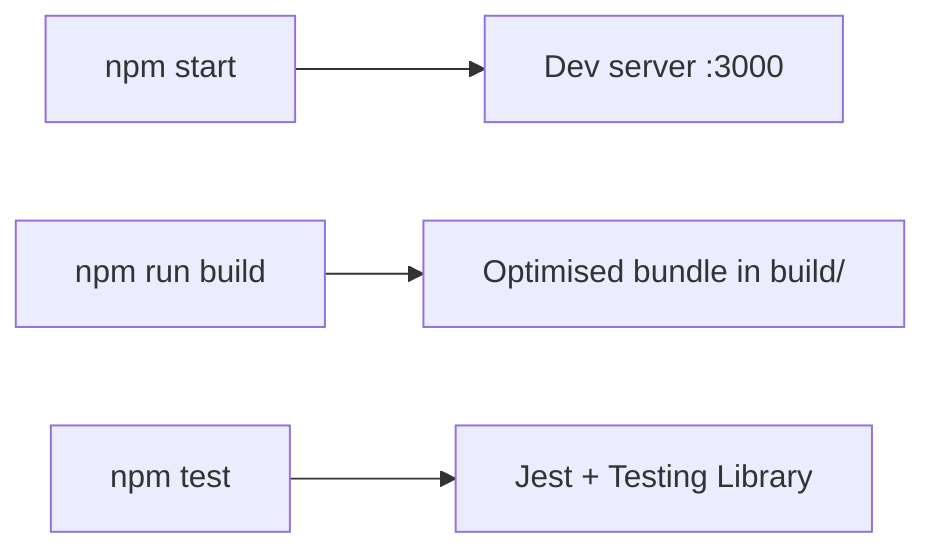

# ugc_scaler

An early-stage React project. At the moment it contains only the Create React App scaffold (React 19).



## Run locally

```bash
npm install
npm start      # http://localhost:3000
npm test
npm run build  # production build in build/
```
